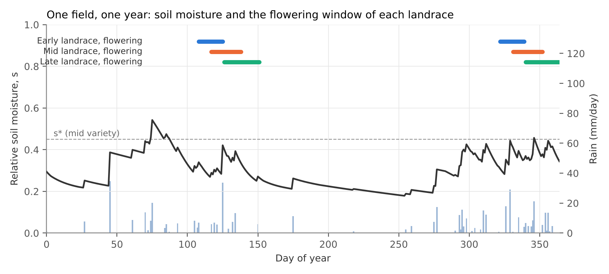
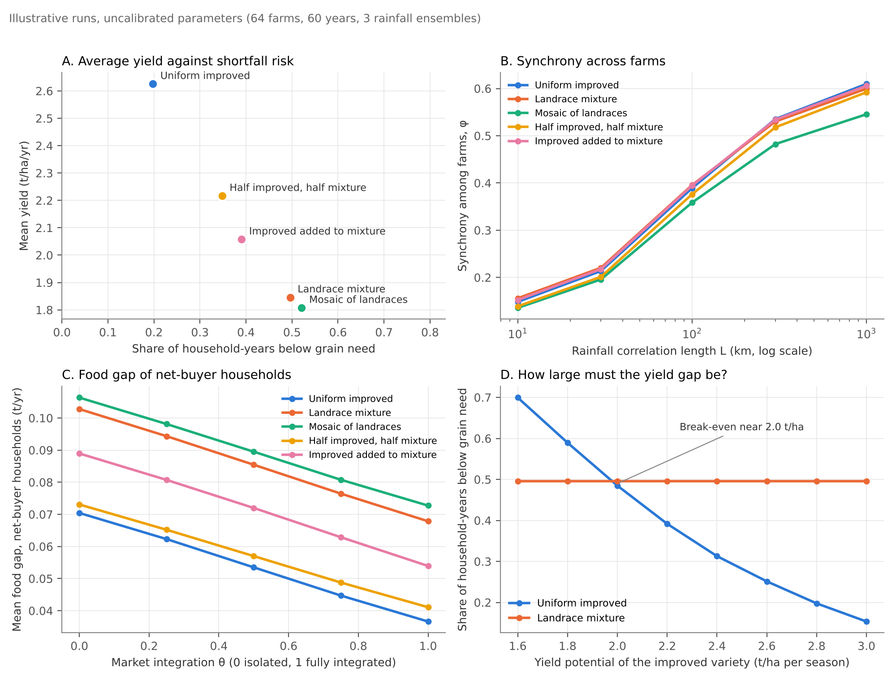

# tessera

Do crop variety mixtures stabilize food supply beyond the field?

`tessera` is a prototype model that follows the effect of crop mixtures from a single field up to regional food supply and local grain markets. A tessera is one tile in a mosaic: each farm is a tile, and the question is whether the whole picture holds together in a bad year.

The model was developed as a possible modeling component for a proposed study of sorghum and maize variety mixtures in East and West Africa. **All parameter values are illustrative and uncalibrated.** Results show how the model behaves, not findings about real farming systems.

## The model

The model has three linked parts.

**1. Soil water and yields.** Each field has a daily stochastic soil water balance in the tradition of Rodriguez-Iturbe et al. (1999) and Laio et al. (2001). All varieties in a field draw on the same soil water. Storms arrive as a Poisson process whose rate varies by season, with ENSO, and from place to place with a set correlation length. Each variety has its own stress threshold, wilting point, maturity and flowering window, and yield falls with the transpiration deficit in each growth stage (Doorenbos and Kassam 1979). Pest and disease losses are more correlated between fields that grow the same varieties.

**2. From fields to the region.** Regional variability is split into the average variability of individual farms and the synchrony among them, using the identity of Wang and Loreau (2014):

```
CV_R^2 = phi * CV_L^2
```

**3. Markets, storage and households.** Regional grain goes into a storage bucket with fixed capacity and losses. The local price depends on local supply and on outside prices, weighted by a market-integration parameter theta. Each household's food gap depends on its own harvest, its cash and the local price, so net buyers and net sellers are affected differently (Deaton 1989).

A fourth part, seed exchange networks and the spread of new varieties, is described in the design but not yet implemented.

## Example output





These runs use 64 farms over 60 years with 3 rainfall ensembles, and five landscapes: all improved variety, all landrace mixture, a mosaic of single landraces, half improved and half mixture, and the improved variety added to the mixture.

## Running it

```
pip install -r requirements.txt
python run_experiments.py
```

This writes `results.csv` and the figures in `figures/`. A full run takes about two minutes on a laptop.

## Files

| File | Contents |
|---|---|
| `mixtures_model.py` | The model: rainfall generator, soil water balance, yields, disease, synchrony, markets |
| `run_experiments.py` | Scenario experiments across rainfall correlation length, market integration and yield potential |
| `make_figures.py` | Figures from `results.csv` |
| `results.csv` | Results of the example runs |

## Where to change things

| What | Where |
|---|---|
| Variety traits (yield potential, stress threshold, wilting point, maturity, yield response) | `VARIETIES` in `mixtures_model.py` |
| Soil | `Soil` |
| Rainfall climatology, ENSO loading, correlation lengths | `Climate` |
| Pest and disease losses | `Disease` |
| Storage, demand elasticity, market integration, household need and cash | `Market` |
| Landscapes | `scenarios()` in `run_experiments.py` |

## Known simplifications

- One root zone, so differences in rooting depth between varieties are not represented.
- Fixed planting dates. In practice farmers wait for the rains to start.
- Varieties in a mixture interact only through shared soil water. There is no light competition and no disease dilution within the field.
- One regional market with a simple storage rule. The competitive storage model would be the standard alternative.
- Seed networks are not yet implemented.

## References

Deaton, A. (1989). Rice prices and income distribution in Thailand: a non-parametric analysis. *Economic Journal*, 99(395), 1–37.

Doorenbos, J., and Kassam, A. H. (1979). *Yield Response to Water*. FAO Irrigation and Drainage Paper 33. Rome: FAO.

Laio, F., Porporato, A., Ridolfi, L., and Rodriguez-Iturbe, I. (2001). Plants in water-controlled ecosystems: active role in hydrologic processes and response to water stress. II. Probabilistic soil moisture dynamics. *Advances in Water Resources*, 24(7), 707–723.

Rodriguez-Iturbe, I., Porporato, A., Ridolfi, L., Isham, V., and Cox, D. R. (1999). Probabilistic modelling of water balance at a point: the role of climate, soil and vegetation. *Proceedings of the Royal Society A*, 455(1990), 3789–3805.

Wang, S., and Loreau, M. (2014). Ecosystem stability in space: α, β and γ variability. *Ecology Letters*, 17(8), 891–901.

## Contact

Michael J. Puma, Center for Climate Systems Research, Columbia University.
