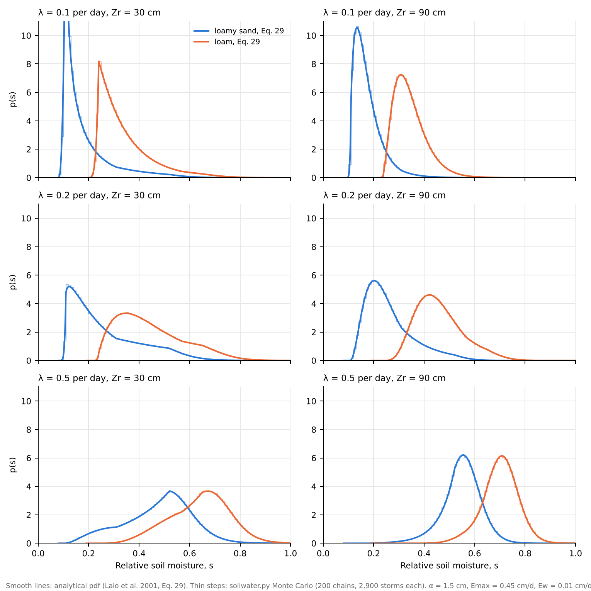
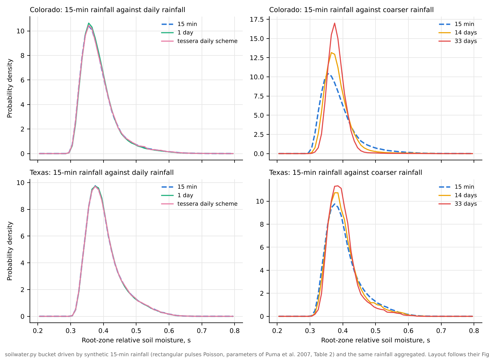

# tessera

<p align="center"></p>

Do crop variety mixtures stabilize food supply beyond the field?

`tessera` is a prototype model that follows the effect of crop mixtures from a single field up to regional food supply and local grain markets. A tessera is one tile in a mosaic: each farm is a tile, and the question is whether the whole picture holds together in a bad year.

The model was developed as a possible modeling component for a proposed study of sorghum and maize variety mixtures in East and West Africa. **All parameter values are illustrative and uncalibrated.** Results show how the model behaves, not findings about real farming systems.

## The model

The model has three linked parts. Field $i$ is a farm, $t$ is a year and $v$ is a variety.

### 1. Soil water and yields

Each field has a daily stochastic soil water balance in the tradition of Rodriguez-Iturbe et al. (1999) and Laio et al. (2001), in `soilwater.py`:

$$nZ_r \frac{ds}{d\tau} = I(\tau) - \sum_v c_v\left[E_w\,r_v(s) + (E_{max,v} - E_w)\,f_v(s)\right] - (1 - C)\,E_b\,b(s) - \Lambda(s)$$

- $s$ is relative soil moisture, from 0 (dry) to 1 (saturated), and $\tau$ is the day.
- $n$ is soil porosity and $Z_r$ is root zone depth (mm), so $nZ_r$ is the water the root zone can hold.
- $I$ is rain that infiltrates: each day's rain (see Rainfall below), applied at the start of the day. Rain beyond saturation runs off.
- $c_v$ is the canopy cover of variety $v$: its planting share times its cover at that point in the season. $C = \sum_v c_v$. All varieties in a field draw on the same soil water.
- $f_v(s)$ is the stomatal control of transpiration. It is 1 above the variety's stress threshold $s^*_v$, falls linearly to 0 at its wilting point $s_{w,v}$, and $E_{max,v}$ is its maximum evapotranspiration.
- $r_v(s)$ ramps evaporation and cuticular losses $E_w$ from 0 at the hygroscopic point $s_h$ to 1 at $s_{w,v}$.
- $E_b\,b(s)$ is evaporation from bare soil, rising linearly from $s_h$ to field capacity $s_{fc}$.
- $\Lambda(s) = K_s\left(e^{\beta(s - s_{fc})} - 1\right) / \left(e^{\beta(1 - s_{fc})} - 1\right)$ for $s > s_{fc}$ is leakage below the root zone.

For a single variety at full cover ($c_v = 1$) this is exactly the loss function of Laio et al. (2001), Eq. 16. Losses are integrated with adaptive second-order sub-steps. The scheme is checked against the published analytical results in [`validation/`](validation/).

#### Rainfall

Rainfall is generated in `generate_rain()` in `mixtures_model.py`. It is a marked Poisson process, the rainfall model of Rodriguez-Iturbe et al. (1999) and Laio et al. (2001), extended in three ways: the storm rate follows the seasons, it shifts from year to year with ENSO, and it is correlated between farms over a set distance. It is built in four layers.

**1. Storms and daily totals.** Storms arrive as a Poisson process with rate $\kappa$ (storms per day), and each storm has an exponentially distributed depth with mean $h$. The model steps once a day, so on day $\tau$ farm $i$ gets a Poisson number of storms, and their total is added to the soil at the start of the day:

$$N_{i,\tau} \sim \text{Poisson}\left(\kappa_i(\tau)\right), \qquad R_{i,\tau} = \sum_{k=1}^{N_{i,\tau}} h_k, \qquad h_k \sim \text{Exponential}(\text{mean } h)$$

A sum of exponential depths is a gamma variable, so $R_{i,\tau}$ is drawn directly as $\text{Gamma}(N_{i,\tau}, h)$. Puma et al. (2007) showed that daily rainfall reproduces the root-zone soil moisture and transpiration given by 15-minute rainfall, which is why a daily step is enough; this is checked again in [`validation/`](validation/).

**2. Seasons.** The storm rate follows the bimodal calendar of semi-arid East Africa: a low base rate $\kappa_0$ in the dry months, and seasonal rates $\kappa_{LR}$ for the long rains (days 60 to 151) and $\kappa_{SR}$ for the short rains (days 274 to 365).

**3. ENSO and seasonal anomalies.** Within each rainy season, the rate for farm $i$ in year $y$ is

$$\kappa_i(\tau, y) = \kappa_{season}\,\exp\left(\lambda_{season} E_y + \eta_{i,y}\right)$$

- $E_y$ is an ENSO index that persists from year to year: $E_y = a E_{y-1} + \sqrt{1 - a^2}\,\varepsilon_y$, with $\varepsilon_y$ standard normal.
- $\lambda_{season}$ is the ENSO loading. It is positive for the short rains, so El Niño years bring more short-rains storms, and slightly negative for the long rains.
- $\eta_{i,y}$ is a seasonal anomaly: whether this particular season is wet or dry at this farm, beyond ENSO. It is normally distributed with standard deviation $\sigma_\eta$, and drawn separately for each season.

**4. Space.** Rainfall is correlated between farms at two scales:

- **Seasons.** The anomalies $\eta$ of two farms a distance $d_{ij}$ apart are correlated as $e^{-d_{ij}/L}$. The **rainfall correlation length** $L$ is roughly how far a good or bad season extends. A short $L$ means neighboring farms often have different seasons; a long $L$ means a whole region has a good or bad season together.
- **Storms.** Daily storm counts are correlated over a shorter distance $L_{day}$, so nearby farms tend to get rain on the same days. This uses a Gaussian copula: correlated standard normal draws $z_{i,\tau}$ are turned into Poisson counts, $N_{i,\tau} = F^{-1}_{\text{Poisson}(\kappa)}\left(\Phi(z_{i,\tau})\right)$, with $\mathrm{corr}(z_i, z_j) = e^{-d_{ij}/L_{day}}$.

$L$ is the parameter that matters most for the regional results: in the example runs, synchrony among farms rises from about 0.15 to 0.58 as $L$ goes from 10 to 1,000 km (panel B of the scenario figure).

| Symbol | Meaning | Value | In `Climate` |
|---|---|---|---|
| $\kappa_0$ | storm rate outside the rains | 0.04 per day | `p_base` |
| $\kappa_{LR}$, $\kappa_{SR}$ | storm rate in the long and short rains | 0.30, 0.28 per day | `p_long`, `p_short` |
| $h$ | mean storm depth | 9 mm | `h` |
| $a$ | year-to-year persistence of ENSO | 0.5 | `enso_ar` |
| $\lambda_{LR}$, $\lambda_{SR}$ | ENSO loading on the long and short rains | -0.10, 0.35 | `load_long`, `load_short` |
| $\sigma_\eta$ | spread of seasonal anomalies | 0.35 | `sigma_eta` |
| $L$ | correlation length of seasonal anomalies | 100 km (varied 10 to 1,000) | `L` |
| $L_{day}$ | correlation length of storms | 20 km | `L_day` |

With these values a farm gets about 555 mm a year on about 53 rain days, split roughly evenly between the two seasons, and the regional mean varies by about 94 mm from year to year. The values are illustrative and have not been fitted to any record.

**Limitations.** Apart from the shifts by season, ENSO and seasonal anomaly, rainy days occur independently from one day to the next, so the model does not reproduce the persistence of wet and dry spells seen in real records. Dry spells during flowering matter for the mixture question, so the first step at a real site would be to fit the storm rates, depths, spell statistics and correlation lengths to daily rainfall such as CHIRPS. Clustered models such as Neyman–Scott are an option, but Puma et al. (2007) found that the simpler rectangular pulses model, with parameters fitted to daily data, predicts soil moisture and transpiration about as well.

#### Yields

Each variety's yield falls with its transpiration deficit in each growth stage (vegetative, flowering, grain fill), weighted by yield response factors $K_y$ (Doorenbos and Kassam 1979). Varieties differ in maturity, so their flowering windows fall on different days. Pest and disease losses are more correlated between fields that grow the same varieties.

### 2. From fields to the region

Regional production is the sum over farms. Its variability is split into how variable individual farms are and how much they move together, using the identity of Wang and Loreau (2014):

$$CV_R^2 = \varphi \, CV_L^2$$

where, with $m_i$ the mean production of farm $i$ and $\sigma_{ij}$ the covariance of production between farms $i$ and $j$ (so $\sigma_i = \sqrt{\sigma_{ii}}$ is farm $i$'s standard deviation):

$$CV_L = \frac{\sum_i \sigma_i}{\sum_i m_i}, \qquad CV_R = \frac{\sqrt{\sum_i \sum_j \sigma_{ij}}}{\sum_i m_i}, \qquad \varphi = \frac{\sum_i \sum_j \sigma_{ij}}{\left(\sum_i \sigma_i\right)^2}$$

- $CV_L$ is **local variability**: the coefficient of variation of a typical farm's production from year to year, weighted by farm size.
- $CV_R$ is **regional variability**: the coefficient of variation of total regional production.
- $\varphi$ is **synchrony**, between 0 and 1. It is 1 when all farms rise and fall together and close to 0 when their good and bad years are independent.

Regional supply can therefore be steady for two reasons: farms are individually steady (low $CV_L$), or their bad years do not line up (low $\varphi$).

### 3. Markets, storage and households

Regional grain goes into a storage bucket. Each year, grain above normal demand is stored up to a capacity $S_{max}$, stored grain loses a share $\delta$ per year, and stocks are drawn down in poor years. The local price $p_t$ then depends on the grain available, $Q_t$:

$$\ln p_t = (1-\theta)\left[\ln \bar{p} - \frac{1}{\varepsilon}\ln\frac{Q_t}{\bar{C}}\right] + \theta \ln p^w_t$$

- $\bar{p}$ is the price in a normal year and $\bar{C}$ is normal regional demand, set to the mean regional harvest.
- $\varepsilon$ is the price elasticity of demand. A low value means prices swing strongly with the harvest.
- $p^w_t$ is the outside (import parity) price.
- $\theta$ is **market integration**, from 0 to 1. At 0 the local price is set entirely by the local harvest; at 1 it is set entirely by outside prices.

For each household, the **food gap** is the grain it needs but can neither grow nor buy:

$$G_{h,t} = \max\left(R_h - y_{h,t} - \frac{I_{h,t}}{p_t},\ 0\right)$$

where $R_h$ is the household's grain need, $y_{h,t}$ its harvest and $I_{h,t}$ the cash it can spend on grain. A **net buyer** is a household that on average harvests less grain than it needs; a **net seller** harvests more. A price rise helps net sellers and hurts net buyers (Deaton 1989).

A fourth part, seed exchange networks and the spread of new varieties, is described in the design but not yet implemented.

### Outputs

- **Shortfall risk:** the share of household-years in which a household's harvest is below its grain need.
- **Mean run length:** the average number of consecutive years in shortfall. The model has memory through soil moisture, ENSO and grain stocks, so bad years can cluster.
- **Regional deficit:** the share of years in which total regional production is below total household need.

## Example output


These runs use 64 farms over 60 years with 3 rainfall ensembles, and five landscapes: all improved variety, all landrace mixture, a mosaic of single landraces, half improved and half mixture, and the improved variety added to the mixture.

## Validation

The soil water model is checked against published results in [`validation/`](validation/):

- **Laio et al. (2001).** For a single variety at full cover the model is their model, and it reproduces their closed-form drydown (Eq. 20), steady-state soil moisture pdfs (Eq. 29) and water balance (Eqs. 36-44).
- **Puma et al. (2007).** Repeating their rainfall-resolution experiment with the bucket shows that daily rainfall, and the daily scheme used here, give the same root-zone soil moisture distribution as 15-minute rainfall, while 2-week and monthly rainfall do not.

The bucket does not capture the effects of the vertical soil profile. These are discussed under limitations in the validation notes.





## Running it

```
pip install -r requirements.txt
python run_experiments.py
```

This writes `results.csv` and the figures in `figures/`. A full run takes about two minutes on a laptop.

## Files

| File | Contents |
|---|---|
| `soilwater.py` | Point soil water balance (loss function of Laio et al. 2001) and its integrator |
| `mixtures_model.py` | The model: rainfall generator, yields, disease, synchrony, markets |
| `validation/` | Checks of the soil water model against Laio et al. (2001) and Puma et al. (2007) |
| `run_experiments.py` | Scenario experiments across rainfall correlation length, market integration and yield potential |
| `make_figures.py` | Figures from `results.csv` |
| `results.csv` | Results of the example runs |

## Where to change things

| What | Where |
|---|---|
| Variety traits (yield potential, stress threshold, wilting point, maturity, yield response) | `VARIETIES` in `mixtures_model.py` |
| Soil | `Soil` |
| Rainfall climatology, ENSO loading, correlation lengths | `Climate` |
| Pest and disease losses | `Disease` |
| Storage, demand elasticity, market integration, household need and cash | `Market` |
| Landscapes | `scenarios()` in `run_experiments.py` |

## Known simplifications

- One well-mixed root zone. Vertical redistribution and differences in rooting depth between varieties are not represented. A one-dimensional soil water flow model such as [SoilWaterFlow](https://github.com/mjpuma/SoilWaterFlow) could be used as a benchmark at a few sites (see [`validation/`](validation/)).
- Fixed planting dates. In practice farmers wait for the rains to start.
- Varieties in a mixture interact only through shared soil water. There is no light competition and no disease dilution within the field.
- One regional market with a simple storage rule. The competitive storage model would be the standard alternative.
- Seed networks are not yet implemented.

## References

Deaton, A. (1989). Rice prices and income distribution in Thailand: a non-parametric analysis. *Economic Journal*, 99(395), 1–37.

Doorenbos, J., and Kassam, A. H. (1979). *Yield Response to Water*. FAO Irrigation and Drainage Paper 33. Rome: FAO.

Laio, F., Porporato, A., Ridolfi, L., and Rodriguez-Iturbe, I. (2001). Plants in water-controlled ecosystems: active role in hydrologic processes and response to water stress. II. Probabilistic soil moisture dynamics. *Advances in Water Resources*, 24(7), 707–723.

Puma, M. J., Rodriguez-Iturbe, I., Celia, M. A., and Guswa, A. J. (2007). Implications of rainfall temporal resolution for soil-moisture and transpiration modeling. *Transport in Porous Media*, 68, 37–67.

Rodriguez-Iturbe, I., Porporato, A., Ridolfi, L., Isham, V., and Cox, D. R. (1999). Probabilistic modelling of water balance at a point: the role of climate, soil and vegetation. *Proceedings of the Royal Society A*, 455(1990), 3789–3805.

Wang, S., and Loreau, M. (2014). Ecosystem stability in space: α, β and γ variability. *Ecology Letters*, 17(8), 891–901.

## Contact

Michael J. Puma, Center for Climate Systems Research, Columbia University.
