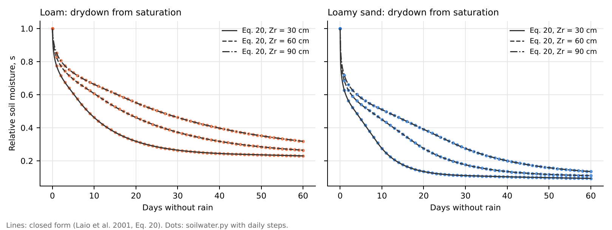
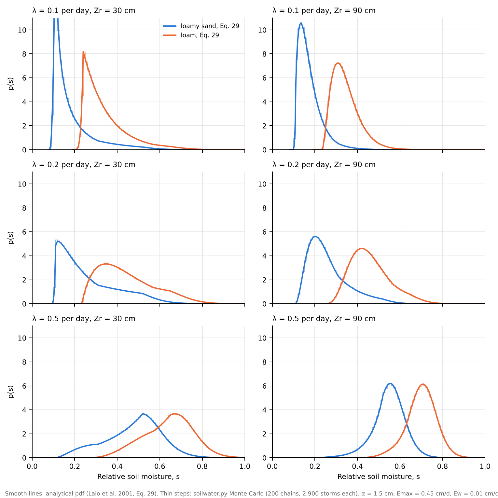
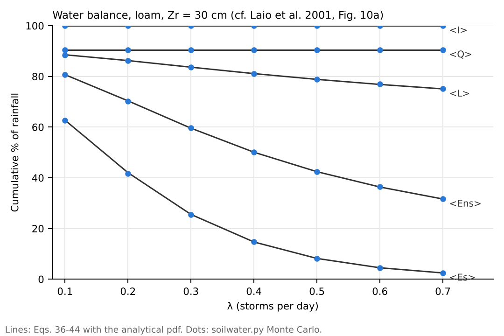
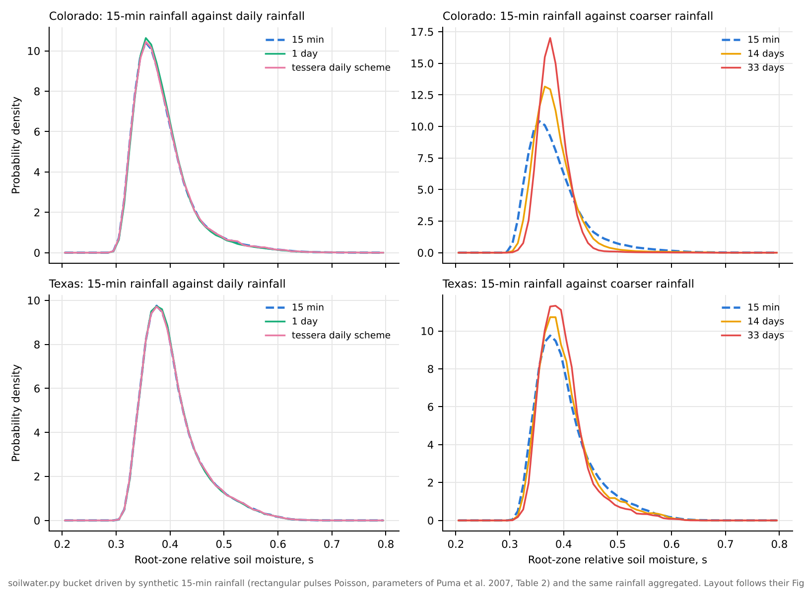
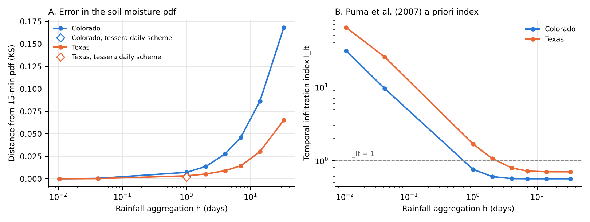

# Validation of the soil water model

These scripts check the point soil water balance in `soilwater.py`, the bucket model at the core of `tessera`, against two published studies. Run them from the repository root:

```
python validation/laio2001.py     # about 7 minutes
python validation/puma2007.py     # about 3 minutes
```

## 1. Laio et al. (2001): the analytical solution

For a single variety at full canopy cover, `soilwater.py` uses exactly the loss function of Laio et al. (2001), Eq. 16: evapotranspiration controlled by the stress threshold $s^*$ and wilting point $s_w$, evaporation down to the hygroscopic point $s_h$, and exponential leakage above field capacity $s_{fc}$. The paper gives closed-form results for this model, so the numerical scheme can be checked exactly. Soil parameters are from their Table 1.

| Test | Paper | Result |
|---|---|---|
| Drydown from saturation, loam and loamy sand, $Z_r$ = 30, 60, 90 cm | Eq. 20, Fig. 7 | Largest error in $s$ is 0.0001 with fine steps and 0.0009 with the daily steps used in `tessera` |
| Steady-state pdf of soil moisture, 12 cases | Eq. 29, Fig. 8 | Mean and standard deviation within 0.001 of the analytical values in every case. Kolmogorov-Smirnov distance below 0.01 in 23 of 24 runs. |
| Long-run water balance (interception, runoff, leakage, stressed and unstressed evapotranspiration), shallow loam, $\lambda$ from 0.1 to 0.7 per day | Eqs. 36-44, Fig. 10a | Every component within a fraction of a percentage point of the analytical value |

Each case is run two ways. The first uses continuous-time Poisson storms, as in the paper. The second uses the `tessera` scheme: each day's storms are summed and added at the start of the day, followed by one day of losses. Both reproduce the analytical results.

**Drydown** (cf. Laio et al. 2001, Fig. 7). Lines: closed form. Dots: the model with daily steps.



**Steady-state soil moisture pdfs** (cf. Fig. 8). Smooth lines: analytical pdf. Thin steps: the model.



**Water balance** (cf. Fig. 10a). Lines: analytical. Dots: the model.



Numbers for every case are in `laio2001_results.csv`.

## 2. Puma et al. (2007): is daily rainfall enough?

Puma et al. (2007) drove a soil-plant model with 15-minute rainfall and with the same rainfall aggregated to coarser intervals, for blue grama (*Bouteloua gracilis*) on silty loam in Colorado and honey mesquite (*Prosopis glandulosa*) on sandy loam in Texas. They found that daily rainfall reproduces the 15-minute results for root-zone soil moisture and transpiration, while 2-week and monthly rainfall do not. `tessera` steps once a day, so this is the question that matters for it.

The experiment is repeated here with the bucket model:

- synthetic 15-minute rainfall from the rectangular pulses Poisson model, using the parameters the paper fitted to the 15-minute data (Table 2);
- the paper's soil and plant parameters (Tables 4 and 5), mapped to the Laio et al. loss function;
- evapotranspiration following a 12-hour daytime sinusoid;
- rainfall aggregated to 1 hour and 1, 2, 4, 7, 14 and 33 days and spread evenly over each interval, with ponded water allowed to infiltrate later, as in the paper;
- one extra run with the `tessera` time scheme: daily totals as a pulse at the start of each day and constant daily evapotranspiration.

| | Colorado | Texas |
|---|---|---|
| Distance (KS) of the soil moisture pdf from the 15-minute run, daily rainfall | 0.007 | 0.003 |
| Same, `tessera` daily scheme | 0.003 | 0.002 |
| Same, 14-day rainfall | 0.086 | 0.030 |
| Same, 33-day rainfall | 0.168 | 0.065 |
| Standard deviation of soil moisture, 15 min / 14 days / 33 days (bucket) | 0.054 / 0.039 / 0.027 | 0.054 / 0.050 / 0.044 |
| Same, Puma et al. (2007), Fig. 3 | 0.073 / 0.054 / 0.042 | 0.084 / 0.057 / 0.046 |

The bucket reproduces the paper's main result. Daily rainfall, including the `tessera` daily scheme, gives the same soil moisture distribution as 15-minute rainfall, and coarser rainfall makes the distribution too narrow, more so in Colorado than in Texas.

**Soil moisture pdfs for 15-minute and aggregated rainfall** (layout of Puma et al. 2007, Fig. 5).



**Error against aggregation, and the temporal infiltration index.**



Numbers for every case are in `puma2007_results.csv`.

## Limitations and future work

The bucket does not reproduce one result of Puma et al. (2007). With coarse rainfall, their mean root-zone soil moisture falls, from 0.438 to 0.394 in Colorado and from 0.454 to 0.377 in Texas. In the bucket it barely moves (0.385 to 0.380, and 0.402 to 0.399). The paper explains the drop through the vertical profile. When rain arrives slowly, roots take up water near the surface before it can infiltrate to depth. A single well-mixed root zone cannot represent this. For the same reason, the temporal infiltration index $I_{I,t}$ is not a useful guide for the bucket: it falls below one at daily aggregation for this synthetic rainfall, but the bucket results stay accurate.

Two related limitations follow:

- **Vertical redistribution.** Infiltration, redistribution and uptake within the root zone are lumped into one store. At daily resolution this is adequate for root-zone averages (section 2), but not for questions about water at particular depths.
- **Rooting depth.** All varieties in a field share one root zone. Differences in rooting depth between varieties, which could matter for how mixtures share water, are not represented.

Both could be examined with a one-dimensional Richards-equation model of soil water flow and root uptake, such as [SoilWaterFlow](https://github.com/mjpuma/SoilWaterFlow), the model used in Puma et al. (2007). The natural use is as a benchmark at a few calibrated sites, not as a replacement for the bucket in the scaling runs.

The absolute levels of soil moisture also differ between the bucket and the Richards-equation results (for example a mean of 0.385 against 0.438 in Colorado). The synthetic rainfall and the bucket's lumped root zone both contribute, so only the effect of aggregation is compared above.

## References

Laio, F., Porporato, A., Ridolfi, L., and Rodriguez-Iturbe, I. (2001). Plants in water-controlled ecosystems: active role in hydrologic processes and response to water stress. II. Probabilistic soil moisture dynamics. *Advances in Water Resources*, 24(7), 707–723.

Puma, M. J., Rodriguez-Iturbe, I., Celia, M. A., and Guswa, A. J. (2007). Implications of rainfall temporal resolution for soil-moisture and transpiration modeling. *Transport in Porous Media*, 68, 37–67.
